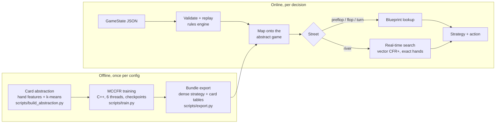

# Regret

An embeddable No-Limit Texas Hold'em agent: an MCCFR blueprint plus real-time search, small enough
(≤ 100 MB) and fast enough (≤ 1 s per decision on a laptop CPU) to drop into your own code.

> **Status: pre-alpha.** Done: rules engine, MCCFR trainer and tooling, card and action
> abstraction, evaluation (baselines, duplicate matches, LBR), the agent library and REST API with
> river re-solving, and bundle packaging. The v1 heads-up blueprint is training now.

## Using the agent

```python
from regret import RegretAgent

agent = RegretAgent.load("bundles/hu-100bb")   # a bundle directory, or a registered name
decision = agent.act({
    "num_players": 2, "hero_seat": "BB", "hero_cards": ["Ah", "Kh"], "street": "preflop",
    "pot": 3.5,
    "players": [{"seat": "BTN", "stack": 97.5, "status": "active"},
                {"seat": "BB", "stack": 99.0, "status": "active"}],
    "action_history": {"preflop": [["BTN", "raise", 2.5]]},
    "to_act": "BB",
})
decision.strategy      # e.g. {"fold": 0.02, "call": 0.61, "raise_3.5x": 0.3, "all_in": 0.07}
decision.recommended   # e.g. {"action": "call", "amount": 2.5}
decision.source        # "blueprint", or "subgame_solve" on the river
```

`act(state, explain=True)` adds the numbers behind the decision (bucket, equity, how off-tree bets
were translated, and on the river the solver's iterations and exploitability). `mode="argmax"`
picks the most likely action instead of sampling; `seed` makes samples reproducible. The game
state format and its validation rules are in [SPEC.md](SPEC.md) §4.

REST API:

```bash
REGRET_BUNDLE=bundles/hu-100bb uv run uvicorn regret.api.app:app --port 8000
curl -s localhost:8000/act -H 'content-type: application/json' -d @state.json
```

`POST /act` (query: `explain`, `mode`, `seed`), `GET /health`, `GET /info`; OpenAPI docs at
`/docs`. Invalid states get a 422 listing each problem with its field.

### Demo table

```bash
scripts/demo.sh bundles/hu-100bb        # then open http://localhost:8765/demo/
```

Play heads-up against Regret, or watch it play one of the baseline bots. Next to the table, a
panel shows each of Regret's decisions: its strategy over the actions it considered, its equity,
which hand group it put its cards in, and on the river the live solver's numbers. While you're
playing, that panel stays hidden until the hand ends, since it would give away Regret's cards.

## Development

Requires [uv](https://docs.astral.sh/uv/) and a C++17 compiler (Xcode Command Line Tools on macOS).
CMake and Ninja are fetched automatically during the build.

```bash
uv sync                # create .venv, build the C++ extension, install dev tools
uv run pytest          # tests
uv run ruff check .    # lint
uv run mypy            # type-check
uv run pre-commit install
```

Editing files under `cpp/` triggers a rebuild on the next `uv sync` or `uv run`.

Exhaustive C++ checks (every 5- and 7-card hand, every flop deal, index round trips) plus an
evaluator benchmark live in a separate binary:

```bash
uv run cmake -S . -B build/cpp-tests -G Ninja -DREGRET_BUILD_TESTS=ON
uv run cmake --build build/cpp-tests
./build/cpp-tests/regret_tests          # ~8 s
./build/cpp-tests/regret_tests --slow   # + every turn deal, every turn/river index (~3 min)
```

## How it works



- **Rules engine** (C++): 2-6 player no-limit hold'em with side pots, fuzzed against PokerKit.
- **Card abstraction:** hands grouped per street by strength and potential (500 buckets
  heads-up), with lossless suit-isomorphic indexing.
- **Blueprint:** external-sampling MCCFR with Linear CFR and pruning, heads-up 100bb, 24.6M
  information sets.
- **Search:** the river is re-solved at decision time over all 1,326 hands with a richer bet
  menu, from ranges the blueprint implies.
- **Evaluation:** baseline bots, duplicate matches with confidence intervals, and LBR
  exploitability. Results are in [RESULTS.md](RESULTS.md).

## Training

Training runs for hours to days, so it checkpoints automatically, resumes exactly, and stops
cleanly. Everything for a run lives in one directory (`runs/<name>/` by default): `checkpoints/`,
`metrics.jsonl`, `train.log`, `tb/` (TensorBoard) and `config.yaml`.

```bash
uv run python scripts/train.py configs/leduc.yaml            # foreground; Ctrl+C checkpoints and exits
uv run python scripts/train.py configs/leduc.yaml --resume   # continue from the latest checkpoint
uv run python scripts/status.py runs/leduc                   # progress, ETA, memory, last eval
uvx tensorboard --logdir runs                                # charts (optional)
```

The toy configs (`kuhn`, `kuhn3`, `leduc`) validate the solver in seconds; hold'em training
arrives in ROADMAP M4. Before it, build the card abstraction once (about 16 minutes on an M2 Pro,
264 MB under `artifacts/`) and check the blueprint's memory needs:

```bash
uv run python scripts/build_abstraction.py configs/hu_default.yaml
uv run python scripts/plan_memory.py configs/hu_default.yaml
```

- **Checkpoints** are written every `checkpoint_every_iterations` and every
  `checkpoint_every_minutes`, atomically (temp file, fsync, rename), with a checksum; the newest
  `keep_last_checkpoints` are kept. A crash mid-write can't damage the latest good checkpoint.
- **Resume** refuses a checkpoint made with a different game, CFR schedule or seed. With
  `training.deterministic: true` (one thread) a resumed run is bit-for-bit identical to an
  uninterrupted one; multithreaded runs are statistically equivalent but not bit-exact.
- **Stopping:** Ctrl+C or `kill -TERM $(cat runs/<name>/train.pid)` finishes the current
  chunk (under a second), checkpoints and exits 0. A second Ctrl+C aborts immediately.

### On a laptop (macOS)

```bash
scripts/run_background.sh configs/leduc.yaml     # tmux if installed, else nohup
uv run python scripts/status.py runs/leduc       # check in any time
```

On a Mac it **trains only while plugged in**: unplug and it checkpoints and pauses, plug back in
and it resumes (`scripts/train_when_plugged.sh`; log in `runs/<name>/watcher.log`). Set
`ALLOW_BATTERY=1` to train on battery anyway. Keep the lid open (closing it sleeps the Mac, which
pauses training) and the vents clear. The script always resumes, so after a reboot or crash just
run it again. Install tmux (`brew install tmux`) to be able to reattach to the live
output with `tmux attach -t regret-leduc` (detach: Ctrl+B, then D).

### On a rented cloud server (Linux)

```bash
# setup (once)
curl -LsSf https://astral.sh/uv/install.sh | sh && sudo apt-get install -y build-essential tmux
git clone https://github.com/VisheshV5/nash.git && cd nash && uv sync

# launch, then log out: the tmux session keeps running
scripts/run_background.sh configs/leduc.yaml
exit

# later: reattach or just check status
ssh server -t 'cd nash && tmux attach -t regret-leduc'
ssh server 'cd nash && uv run python scripts/status.py runs/leduc'

# download checkpoints and logs
rsync -avz server:nash/runs/leduc/ runs/leduc/
```

Set `training.threads` to the server's core count. `status.py` only reads files, so it's safe
to run while training continues.

## Layout

| Path | What |
|---|---|
| `cpp/` | Native core (engine, abstraction, CFR, search) exposed to Python as `regret._core` |
| `src/regret/` | Python package: config, orchestration, agent, API, eval |
| `configs/` | YAML configs: `hu_default.yaml` (hold'em), `kuhn`/`kuhn3`/`leduc` (solver validation) |
| `scripts/` | `train.py`, `status.py`, `run_background.sh`, `build_abstraction.py`, `plan_memory.py` |
| `tests/` | pytest suite (+ `fuzz_pokerkit.py` for the full engine fuzz) |

## License

MIT
